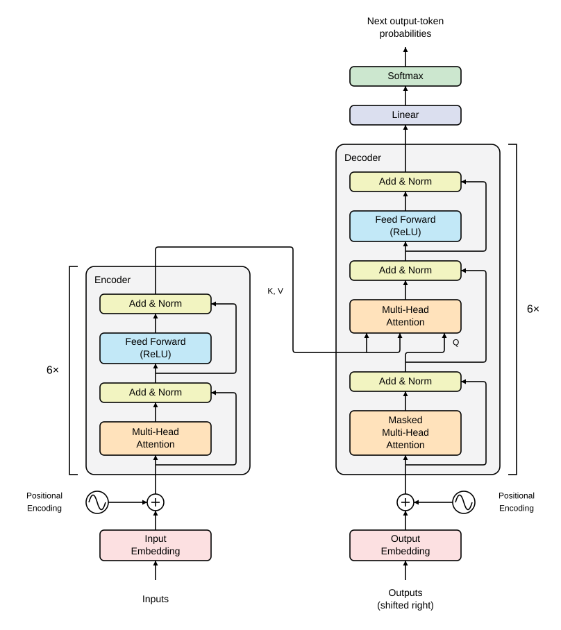

# transformer

My NumPy implementation of [Transformer][paper].

The script initialises random weights and prints its output probability shape:

```shell
uv run transformer.py
```

**Transformer** predicts the next output token for sequence-to-sequence tasks
such as translation:



```python
def transformer(inputs, outputs_shifted_right=np.array([hp["bos_id"]])):
    x = token_embedding(inputs) + positional_encoding(len(inputs))
    x = dropout(x)
    z = encoder(x)

    y = token_embedding(outputs_shifted_right) + positional_encoding(len(outputs_shifted_right))
    y = dropout(y)
    y = decoder(y, z)
    logits = linear(y)
    return softmax(logits)
```

[paper]: https://arxiv.org/abs/1706.03762
