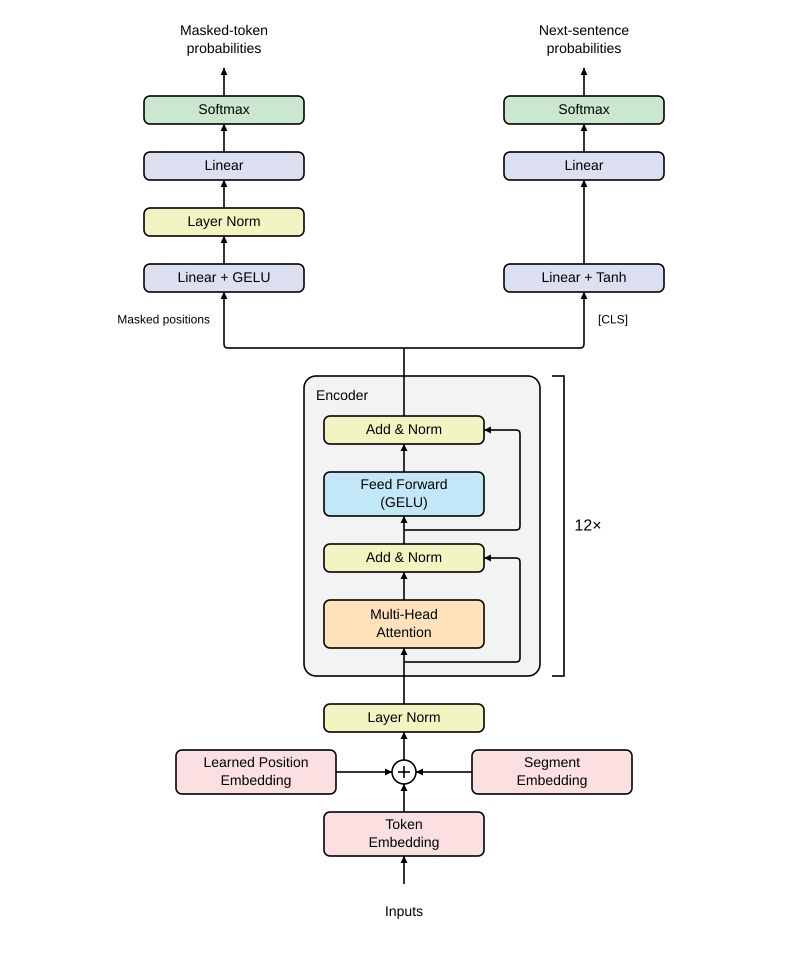
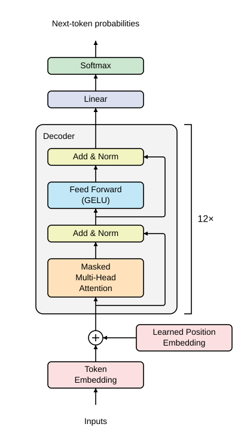

# transformer

My NumPy implementations of [Transformer][paper], [BERT][bert-paper], and
[GPT][gpt-paper].

Each script initialises random weights and prints its output probability shapes:

```shell
uv run transformer.py
uv run bert.py
uv run gpt.py
```

**Transformer** predicts the next output token for sequence-to-sequence tasks
such as translation:


```python
def transformer(inputs, outputs_shifted_right=np.array([hp["bos_id"]])):
    x = token_embedding(inputs) + positional_encoding(len(inputs))
    x = dropout(x)
    z = encoder(x)

    y = token_embedding(outputs_shifted_right) + positional_encoding(len(outputs_shifted_right))
    y = dropout(y)
    y = decoder(y, z)
    logits = linear(y)
    return softmax(logits)
```

**BERT** pre-training uses masked language modelling and next-sentence prediction:



```python
def bert(inputs, segment_ids, masked_positions):
    x = token_embedding(inputs) + position_embedding(len(inputs)) + segment_embedding(segment_ids)
    x = layer_norm(x, "embed")
    x = dropout(x)
    z = encoder(x)

    masked_probabilities = masked_lm(z[masked_positions])
    next_sentence_probabilities = next_sentence(z[0])
    return masked_probabilities, next_sentence_probabilities
```

**GPT** pre-training uses next-token prediction (causal language modelling):



```python
def gpt(inputs):
    x = token_embedding(inputs) + position_embedding(len(inputs))
    y = decoder(x)
    logits = linear(y)
    return softmax(logits)
```

[paper]: https://arxiv.org/abs/1706.03762
[bert-paper]: https://arxiv.org/abs/1810.04805
[gpt-paper]: https://cdn.openai.com/research-covers/language-unsupervised/language_understanding_paper.pdf
